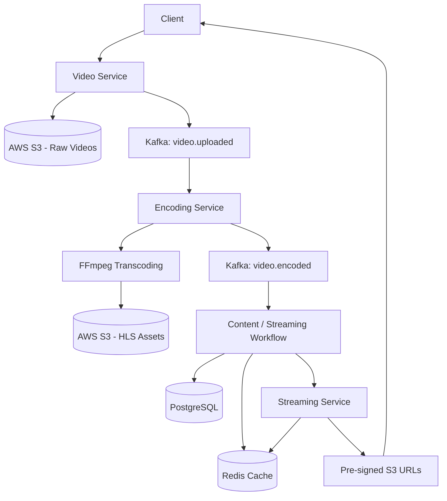

# Netflix-Style Adaptive Bitrate Video Streaming Platform

An event-driven, microservices-based video streaming platform built with **Java, Spring Boot, Apache Kafka, Redis, AWS S3, and FFmpeg**. The system asynchronously processes uploaded videos into multiple HTTP Live Streaming (HLS) quality levels and provides secure, time-limited access to streaming content.

The project explores backend architecture and distributed systems concepts used in modern video streaming platforms, including asynchronous processing, cloud object storage, caching, and adaptive bitrate playback.

## Key Features

- **Microservices Architecture:** Four independently organized Spring Boot services with distinct responsibilities.
- **Asynchronous Video Processing:** Kafka decouples video uploads from resource-intensive transcoding.
- **Adaptive Bitrate Streaming:** Generates HLS renditions at 1080p, 720p, 480p, and 360p.
- **Cloud Object Storage:** Uses Amazon S3 to store original videos and encoded streaming assets.
- **Redis Caching:** Caches streaming URLs and supports duplicate-encoding checks.
- **Secure Video Delivery:** Uses pre-signed S3 URLs to provide temporary access to private objects.
- **Event-Driven Communication:** Kafka events connect upload, encoding, and streaming workflows.
- **Persistent Metadata:** PostgreSQL stores video metadata and storage references.

## Architecture



*Conceptual architecture; the exact event consumers and metadata update sequence depend on the implemented service code.*

## Microservices Breakdown

### 1. Content Service

**Technology:** Spring Boot, PostgreSQL

Responsible for managing video metadata and storage references.

- Maintains movie information and associated identifiers.
- Stores references to raw and processed video assets.
- Provides the metadata layer used by the video processing and streaming workflows.

### 2. Video Service

**Technology:** Spring Boot, AWS S3, Apache Kafka

Handles incoming video uploads and initiates asynchronous processing.

- Accepts video files through multipart HTTP uploads.
- Uploads original files to S3 under structured storage keys.
- Publishes a `VideoUploadedEvent` to the `video.uploaded` Kafka topic.
- Includes movie identifiers, original filenames, file sizes, and S3 object references in the event.

Example storage-key pattern:

```text
raw/{movieId}/{uuid}_{originalFilename}
```

### 3. Encoding Service

**Technology:** Spring Boot, Apache Kafka, FFmpeg, AWS S3

Processes uploaded videos asynchronously.

- Consumes `VideoUploadedEvent` messages.
- Uses FFmpeg to transcode videos into multiple quality renditions.
- Generates HLS playlists (`.m3u8`) and media segments (`.ts`).
- Stores the encoded assets in S3.
- Publishes an encoding-completion event for downstream processing.

Configured quality profiles:

| Resolution | Target video bitrate |
|---|---:|
| 1080p | 5000 kbps |
| 720p | 2800 kbps |
| 480p | 1200 kbps |
| 360p | 800 kbps |

These are encoding targets; actual output quality and bitrate can vary with the source video and encoder settings.

### 4. Streaming Service

**Technology:** Spring Boot, Redis, AWS S3

Handles the delivery of secure streaming URLs.

- Generates pre-signed URLs for private S3 objects.
- Caches active streaming URLs in Redis.
- Uses cache expiry to trigger URL regeneration when a new request arrives after the cached entry expires.
- Supports access to HLS playlists and their associated media segments.

The intention is to let clients retrieve video assets directly from S3 rather than proxying all video traffic through the Spring Boot application.

## Asynchronous Processing with Apache Kafka

Video transcoding is computationally expensive. Performing it synchronously inside an upload request would keep the HTTP request occupied while FFmpeg processes the video.

Kafka separates uploading from encoding:

1. The Video Service uploads the original file to S3.
2. It publishes a `VideoUploadedEvent` to `video.uploaded`.
3. The Encoding Service consumes the event and starts FFmpeg processing.
4. The encoded playlists and segments are stored in S3.
5. The encoding workflow publishes a completion event to `video.encoded`.
6. The downstream workflow makes the processed assets available for streaming.

This design reduces direct coupling between services and allows the encoding workload to be scaled independently, subject to Kafka partitioning and available processing resources.

## Redis Optimization

### Duplicate-Encoding Checks

Redis is used to check whether a movie is already being processed, helping avoid unnecessary FFmpeg executions.

For reliable production behavior, this check should be implemented as an atomic claim or lock with appropriate expiry and failure recovery. A simple check followed by a separate write can allow concurrent duplicate processing.

### Pre-Signed URL Caching

The Streaming Service caches generated URLs to reduce repeated signing operations.

Example key pattern:

```text
streaming:url:{movieId}
```

The implementation uses the following URL lifetime strategy:

| Setting | Duration |
|---|---:|
| Pre-signed S3 URL expiry | 60 minutes |
| Redis cache TTL | 55 minutes |
| Difference | 5 minutes |

The shorter Redis TTL is intended to cause a subsequent request to generate a fresh URL before the previous URL reaches its expiry.

**Important:** Cache expiry does not automatically refresh a URL already held by a video player. The client must request a fresh URL when needed. HLS playlists and their referenced segments must also remain accessible through a suitable URL-signing or delivery strategy.

## AWS S3 Security

The platform is designed to use private S3 object storage with Block Public Access enabled.

- Uses AWS SDK clients to upload and manage objects.
- Uses pre-signed URLs to grant temporary access to authorized objects.
- Keeps video payloads out of ordinary backend playback responses where direct S3 delivery is used.
- Separates raw uploads from encoded streaming assets through distinct key prefixes.

AWS credentials should be supplied through environment variables, an AWS credentials profile, or an IAM role rather than committed to source control. For deployed workloads, IAM roles and least-privilege permissions are preferable to long-lived static access keys.

## Technology Stack

| Component | Technology |
|---|---|
| Language | Java |
| Backend framework | Spring Boot |
| Microservices messaging | Apache Kafka |
| Relational database | PostgreSQL |
| Cache | Redis |
| Object storage | Amazon S3 |
| Video transcoding | FFmpeg |
| Streaming format | HTTP Live Streaming (HLS) |
| Build tool | Maven |

## Local Development

### Prerequisites

Install and configure:

- Java version compatible with the service projects
- Maven
- Apache Kafka
- Redis
- PostgreSQL
- FFmpeg
- An AWS account and an appropriately permissioned S3 bucket

### Configuration

Configure each service's application properties or environment variables for its dependencies, including:

- Kafka bootstrap server and topic configuration
- Redis connection settings
- PostgreSQL connection details where applicable
- AWS region and S3 bucket name
- AWS credentials or the configured AWS credential provider
- FFmpeg executable availability

Never commit real credentials, passwords, access tokens, or private configuration files.

### Run the Services

1. Start PostgreSQL, Redis, Kafka, and the required supporting infrastructure.
2. Configure the AWS S3 bucket and application credentials.
3. Ensure FFmpeg is installed and available to the Encoding Service.
4. Build each service from its project directory:

   ```bash
   mvn clean package
   ```

5. Start the four Spring Boot applications using their configured profiles.
6. Upload a sample video through the Video Service.
7. Verify that the upload event is published, encoding completes, and the resulting HLS assets are available in S3.
8. Request a streaming URL through the Streaming Service and test playback with an HLS-compatible player.

Exact ports and HTTP endpoint paths depend on the configuration in each service.

## Engineering Considerations

The architecture demonstrates several important backend engineering principles:

- **Loose coupling:** Services communicate through events rather than requiring synchronous calls for every processing step.
- **Independent scaling:** Encoding workloads can be scaled separately from API traffic.
- **Caching:** Redis reduces repeated work for frequently requested streaming URLs.
- **Cloud object storage:** S3 stores large video objects independently of application instances.
- **Failure handling:** Production deployments should include retries, idempotent event processing, dead-letter handling, and recovery for interrupted encodings.
- **Observability:** Structured logs, metrics, and distributed tracing can help diagnose failures across service boundaries.

These resilience and operational controls should be considered separately from the core workflow; the presence of a microservices architecture alone does not guarantee fault tolerance or high availability.

## Future Improvements

- Add durable encoding-job state transitions and automatic recovery.
- Implement Kafka retry topics and dead-letter queues.
- Add atomic idempotency controls for concurrent encoding requests.
- Introduce integration tests for S3, Kafka, Redis, and PostgreSQL interactions.
- Add automated builds, deployment pipelines, metrics, and distributed tracing.
- Explore adaptive playback validation using an HLS-compatible video player.

## Project Objective

This project was built to gain practical experience with distributed backend systems, event-driven communication, asynchronous media processing, cloud storage security, caching, and multi-service application design.

It brings together backend development and video-processing workflows in an end-to-end streaming pipeline inspired by the architecture of large-scale video platforms.

---

**Disclaimer:** This is an independent learning project inspired by modern video streaming architectures. It is not affiliated with or an implementation of Netflix's internal systems.
